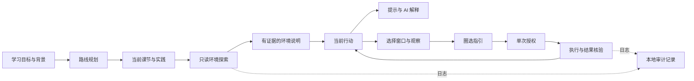

# 学习 Agent 的职责与运行边界

## 结构

本项目是帮助用户学会操作的学习产品。规划、观察、教学、执行和验收分别负责不同的事实，不能互相替代。

- 路线规划：目标、背景、时间与先修关系；描述学习要求，不猜本机状态。
- 课节准备：生成完整教学与练习；把安装、项目配置和实践拆开。
- 环境探索：按任务选择搜索词，读取本机安装登记、App Paths、开始菜单、PATH 与程序版本。仅定向搜索，不读取私人文档或扫描全盘。
- 行动教练：理解完整课程，只帮助当前一步；代码可复制，完成标准可观察。
- 屏幕辅助：先选择窗口，读取控件，圈选目标；只允许当前步骤、当前窗口和控件的一次授权操作。
- 验收：操作工具返回成功不等于课节完成。自行完成、软件已安装、技能已掌握使用不同状态。

## ZCode 复用范围

采用官方 `zai-org/ZCode` 提交 `3c5b227649371507ddc4eb46ac5133afe6db1cab` 的源码。
`learning_ext/agent/zcode_core.py` 是其回合状态机与工具权限判断的 Python 适配，
实际用于环境探索循环及旧动手学对话运行时的生命周期管理。

原始源码、Apache-2.0 许可证、上游声明与修改记录位于 `third_party/zcode/`。
此处没有嵌入完整 ZCode CLI、桌面应用、插件、Hooks 或遥测服务。
模型仍走本项目统一的 `learning_ext.llm`，沿用用户已保存的平台配置。

## 环境探索协议

输入包含学习目标、背景、当前课节与实践，以及已取得的环境证据。
模型输出结构化工具调用；工具名称、参数、权限和返回结果由后端核验。
模型不能声明新工具、改变工具的只读属性或自行执行 Shell。

工具包括任意软件名查询、任意 PATH 命令名定位、候选程序验证、基础工具固定版本探针。
Python、Git 等有专用探针；其他软件通过通用发现与程序元数据验证。
Everything SDK 不是必需依赖；当前没有集成它，也不声称能找到所有便携版软件。

证据状态：

- `ready`：具体固定探针成功且满足已知课程版本要求。
- `present`：确认了程序文件；运行、授权、功能和版本兼容性仍可能待核验。
- `unknown`：发现安装线索，但验证未完成。
- `missing`：本次搜索范围未找到，不代表全机未安装。
- `mismatch`：已取得版本，与课程显式要求不符。

软件发现不限品牌。替代品只作候选，不自动替换课程工具。
来自课程的版本要求不会被模型后续的宽松查询覆盖。
查询结果不含本机完整安装路径、用户名、环境变量值或密钥。
传给当前模型的是任务内容与相关工具名称、版本、状态等最小证据。

每次探索最多4轮，每轮最多3个工具调用；重复查询、工具失败、权限拒绝、模型失败或轮次预算到达时停止。
90秒预算在各轮之间检查，不是正在进行中的模型请求的强制终止器；单个模型请求受统一客户端超时控制。
部分失败时保留已验证证据，未确认的准备不会被跳过。
基础版本探针各自超时4秒，输出限长；程序未知时只读元数据，不运行其 `--version`。

## 步骤调整与呈现

进入“拆解步骤”后，存在环境条件时先显示“从你已有的工具开始”。
用户能看到已确认的工具、待确认项及每一项跳过原因，然后进入具体行动。
最近5分钟的同课节检测可复用；“重新检查环境”强制重新取证。

只有标题和行动均属于纯安装/版本检查，且证据满足要求时，才跳过。
项目创建、虚拟环境、安装依赖、账号登录、启动服务和实践不会因软件存在而跳过。
跳过项与自行完成项分开保存，不修改课节掌握状态。
历史步骤不重写，重检后按当前证据重新计算跳过项。

“学习环境 → 生成配置方案”也先探索本机环境，再生成供用户审阅的方案。
生成和执行保持分离；没有明确的执行点击不会运行安装命令。

## 上下文、权限与日志

共享学习约束在 `learning_ext/agent/prompts.py`；环境探索、拆解、帮助、定位各有明确角色。
课程文本、软件登记、控件名称作为数据处理，不能授予权限。
旧对话运行时压缩历史时保留最初学习目标，并避免截出孤立的工具结果。
空 assistant 回复不入历史，损坏的工具参数不被悄悄替换成空参数执行。

屏幕操作授权绑定课节、步骤、窗口、控件和有效期，单次消费；导航、关闭辅助、换课和重新检查都会撤销。
旧对话运行时移除会话级自动放行，授权绑定参数摘要，90秒过期；同时请求多个有副作用的动作会停止并要求拆成单步。
用户拒绝后本轮结束，模型不能换工具绕过拒绝。

日志写入 `output/runtime/action-learning.sqlite3`，包含会话、课节、步骤、事件、时间、trace、turn、tool call、权限决定和结果。
日志写入发生在执行之前；写入失败不会继续执行操作。密钥样式和密码字段会脱敏。
本地日志可能包含用户问题或控件名称，分享前应审阅；日志不是证明模型结论正确的替代品。

## 验证入口

`tests/test_environment_agent.py` 覆盖通用软件搜索、证据验证、未知工具拒绝、循环停止、失败降级、保守跳过、第一屏与导航、配置预览。
`tests/test_agent_runtime.py` 覆盖一次授权、过期/改参/拒绝、未决操作、上下文压缩、损坏参数和空回复。
原有 `test_action_learning.py` 继续覆盖窗口/控件、单次授权、撤销和日志失败。

本机只读检查：`python scripts/verify_environment_agent.py`。
使用当前已配置模型完成探索：`python scripts/verify_environment_agent.py --live`。
两者均不安装软件，不执行模型生成的命令。
